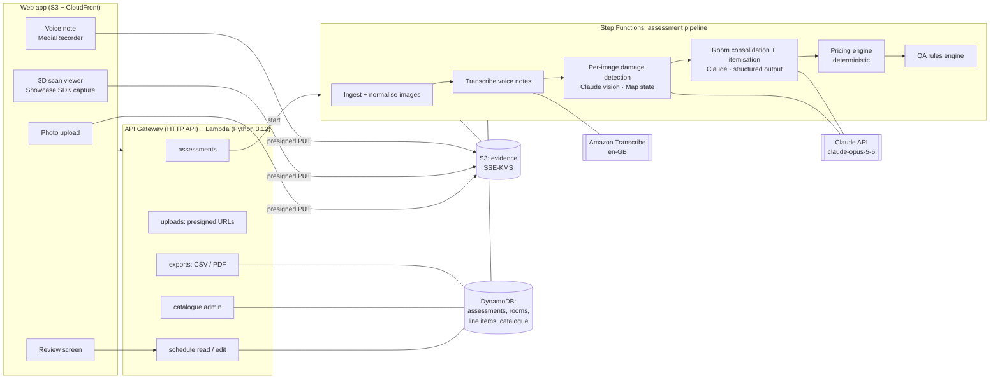

# ClaimScope MVP — Architecture

Status: draft v0.1 · 11 October 2026 · Owner: Onyekachukwu Chukwuka (Dexspace)

ClaimScope turns property evidence (photos, 3D scan views, assessor voice notes) into an itemised, priced schedule of works in the format UK insurers expect. The AI drafts; the assessor reviews and approves.

First customer: a UK loss-assessing firm (name withheld). Delivered as a hosted platform with admin access. See `BUILD_PLAN.md` for the 4-week schedule and `DECISIONS.md` for open decisions.

---

## 1. Design principles

1. **The model never invents a price.** Claude identifies damage, picks catalogue items and chooses a quantity basis. A deterministic pricing engine does all arithmetic from the catalogue. Every £ on a schedule traces to a catalogue row.
2. **Quantities come from geometry, not guesses.** Each room has dimensions; line items reference a *quantity basis* (floor area, wall area, perimeter, count) and the engine computes the number. This removes the most common error in real schedules (linear metres entered as m²; see `QA_RULES.md`).
3. **Visible damage only.** Anything hidden (behind boxing, under floors) becomes an *inspection* item or a flag, never an assumed repair.
4. **Every line carries evidence.** Which photo or scan view, which voice-note sentence, model confidence. Assessors approve lines, not a black box.
5. **Rules check the AI.** A QA rules engine runs after itemisation and before the assessor sees the draft (duplicates, unit mismatches, missing reinstatement pairs, unscheduled rooms).
6. **Serverless and UK-hosted.** AWS `eu-west-2` (London). Near-zero idle cost; per-assessment cost is mostly model usage.

---

## 2. System overview



**Flow for one assessment**

1. Assessor creates an assessment (claim ref, address, peril, date of loss) and adds rooms with dimensions (L × B × H, openings). In the pilot dimensions are typed or corrected by the assessor; scan-derived measurements come later (§6).
2. Evidence goes straight to S3 via presigned URLs: photos (tagged to a room), scan views captured in the browser, voice notes.
3. `POST /assessments/{id}/analyse` starts the Step Functions pipeline. The UI polls status.
4. The pipeline writes a draft schedule (rooms → line items) plus QA findings.
5. The assessor reviews: accept / edit / delete / add lines, resolve flags, then exports CSV (demo) or PDF in the client's report format (pilot).

---

## 3. AI pipeline

Two model stages, then deterministic code. All Claude calls use `claude-opus-5-5`, adaptive thinking, and structured outputs (Pydantic models with `client.messages.parse`), so responses are schema-valid JSON.

### Stage A: per-image damage detection (parallel)

- One call per image (Step Functions Map, concurrency ~5). Input: the image (long edge ≤ 2576 px; native resolution helps fine damage such as hairline cracks and mould spotting), room name, peril, any voice-note text for that room.
- Output: `ImageFindings`, a list of observations: `{surface: floor|wall|ceiling|skirting|fixture|..., element, damage_type: staining|mould|swelling|delamination|cut_out|loose_tiles|..., severity, extent_hint, location_description, visible: true, inspection_needed: bool, confidence}`.
- Effort `medium`. This is perception, not planning.

### Stage B: room consolidation + itemisation (one call per room)

- Input: all `ImageFindings` for the room, the room's dimensions and derived quantities, the transcript excerpts for that room, the peril, and the **catalogue** (item codes, descriptions, units, operation types; no prices).
- Output: `RoomSchedule`, a list of `ProposedLine`: `{item_code, operation, quantity_basis: floor_area|wall_area|ceiling_area|perimeter|count|hours|manual, manual_quantity?, rationale, evidence_refs[], confidence, flags[]}`.
- Effort `high`. This step needs judgement: reinstatement sequences (take up → supply → fit → decorate), whole-room consistency (continuous flooring), and knowing what *not* to add.
- The model picks a basis; it does not do the arithmetic. `manual` is allowed (e.g. "2 cut-out openings") and is flagged for review.

### Prompt caching

The system prompt (instructions + reinstatement rules + few-shot examples drawn from real anonymised schedules) and the catalogue block are identical across calls. They go first, with a `cache_control` breakpoint after the catalogue; per-room content follows. Verify hits with `usage.cache_read_input_tokens`.

### Safety and reliability

- `stop_reason` checked before reading content (`refusal`, `max_tokens`). Server-side fallbacks enabled (`fallbacks: "default"`) per current Claude API guidance.
- Typed exception chain for retries (429 / 5xx / connection) inside each Lambda; Step Functions retry policy on top.
- Every request and response is stored (S3, encrypted) per assessment for audit and for building the evaluation set.

### Why not one big call

Per-image calls run in parallel and keep each request small, and a bad image only fails its own step. Per-room itemisation gives the model one coherent scope with that room's geometry. Consolidating per room is also where duplicate observations across photos are merged.

---

## 4. Pricing engine (deterministic)

```
line_total = quantity × (material_rate + labour_rate)
quantity   = derive(room, quantity_basis)   # or manual_quantity
```

Derived quantities per room (computed once, shown to the assessor):

| Basis | Formula |
|---|---|
| `floor_area` | L × B (or polygon area when scan-derived) |
| `ceiling_area` | = floor_area |
| `wall_area` | perimeter × H − Σ openings |
| `perimeter` (skirting, caulk) | 2(L + B) − Σ door widths |
| `count`, `hours`, `manual` | from the proposed line |

**Catalogue item** (see `schemas/catalogue-item.schema.json`): code, category, description, unit (`M2`, `M`, `EACH`, `NR`, `HR`), operation (`supply`, `fit`, `supply_and_fit`, `take_up`, `remove_dispose`, `remove_set_aside_refit`, `apply`, `prelim`), `material_rate`, `labour_minutes` per unit, `labour_rate_ref`, source and `last_reviewed`.

- **Materials**: priced from current UK retail ranges, from permitted sources only (retailer feeds, affiliate/product APIs, or manual curation with source URL and date). No scraping that breaches retailer terms.
- **Labour**: `labour_minutes × trade_rate`. Trade rates (plasterer, decorator, tiler, plumber, labourer, electrician) are set by the client in admin, e.g. their contractor network's rates.
- This mirrors the insurer schedule structure (separate *Supply Only*, *Fit Only*, *Take up & Dispose* lines), so outputs read the way insurers expect.

**General items (prelims)** are added by rules, not by the model: skip and permit, protection, welfare, dust extraction, electrical test, final clean. Each is driven by assessment-level parameters (e.g. floor level, lift access, days on site) that the assessor confirms.

---

## 5. QA rules engine

Runs after pricing; produces findings shown at the top of the review screen. The initial ruleset was derived from reviewing a real escape-of-water schedule (see `QA_RULES.md`):

- Unit/basis mismatch (an `M2` item whose quantity equals the room perimeter).
- Duplicate lines (same item code + room + operation).
- `EACH`/"per room" items with non-integer quantities.
- Broken reinstatement pairs: take-up without supply + fit; stain block without paint; tiles removed without replacement.
- Continuous-flooring consistency: if any room's floor is replaced and the finish is continuous, every room sharing it must be scheduled.
- Rooms in the scan or floor plan with no lines.
- Same item priced at different rates within one schedule.
- Prelims that don't fit the property (e.g. stairs protection in a single-level flat).

---

## 6. 3D scan capture (Matterport)

The assessor pastes a public Matterport link. Two capture paths feed Stage A exactly like uploaded photos:

1. **Tab capture (default, no SDK key).** The tour is embedded as a normal public iframe. The browser's tab-sharing permission (`getDisplayMedia`) provides frames of the page; the tour's rectangle is cropped out. The assessor picks a room chip and walks the room; a view is kept whenever the camera settles (frame difference below a threshold) on something meaningfully different from the last kept view. A manual "capture this view" button is always there.
2. **URL auto-walk (no SDK key).** The page reloads the embedded tour at every scan point using the `ss` (scan point index) and `sr` (pitch,yaw in radians) link parameters, four views per point, two tours side by side in a full-screen overlay so each frame is visible to tab capture. A scan index past the end loads the start view, so three consecutive start-view matches end a lane. Views upload without a room to `captures/<assessment>/scan_view/<id>`; an S3-triggered Lambda runs Stage A on each as it lands and stores the findings on the evidence record. At draft time the pipeline matches views to known (floor-plan) rooms by vote per scan point, or creates estimated rooms from room-type guesses, then runs Stage B. Captures are kept 30 days in the demo.
3. **SDK auto-walk (optional).** With a working SDK key (sandbox keys only work on localhost; production keys need a paid Matterport plan plus add-on), the app reads `Room.data` (bounds, size, label) and `Sweep.data`, visits up to two scan points per room and takes six `Renderer.takeScreenShot` views at each.

**Rooms and dimensions.** Path 1 captures the tour's floor plan view once; Claude reads room names and length × breadth from it, recording per room whether the size was labelled on the plan, scaled from other labels, or estimated. Path 2 uses room bounding boxes. Both are approximations (no openings deducted, L-shapes as rectangles, heights default 2.4 m) and are editable inline. Programmatic room geometry needs the scan owner's Matterport account and is post-pilot.

---

## 6a. Walkthrough video

Upload (presigned PUT to `videos/<assessment>/<id>`) → S3 event → video Lambda (3 GB, 15 min, own bundle with PyAV/numpy/Pillow):

1. Soundtrack → 16 kHz mono WAV (PyAV; works for .mp4 and .mov) → Amazon Transcribe en-GB in eu-west-2 → timestamped segments. The transcript is kept on the evidence record; Transcribe's job is deleted after reading.
2. Frames: sample 2 per second, keep the sharpest frame within a second each time the view changes enough, minimum 2.5 s apart, at least one every 10 s, max 60, long edge 1568 px. A 5.5-minute phone clip gives 60 frames in about 4 s locally.
3. Claude reads the timeline and returns rooms with time spans, an incident brief (detail, cause, further info) and contents mentioned. Rooms are created with a default size that is re-estimated from the frames at draft time.
4. Each frame is uploaded to `captures/` with its room and that room's commentary near the frame, and analysed like any other view.

Retention: videos and transcripts 30 days, extracted audio 7 days. Local preview against the API while the public site is off: `python3 tools/dev/serve.py`.

## 7. Voice notes

- Browser `MediaRecorder` (webm/opus or m4a), uploaded to S3, transcribed by Amazon Transcribe (batch, `en-GB`, `eu-west-2`).
- Transcript segments are attached to a room (the assessor picks the room when recording, or says the room name; Stage B gets per-room excerpts).
- Voice is context, not authority: a spoken "the skirting's gone in here" raises the prior for that item but still needs visual evidence or an explicit assessor confirmation flag.

---

## 8. Data model (DynamoDB, single table)

| Entity | PK | SK | Notes |
|---|---|---|---|
| Assessment | `ASMT#{id}` | `META` | claim ref, address, peril, dates, status, totals |
| Room | `ASMT#{id}` | `ROOM#{roomId}` | dims, openings, derived quantities, finish refs |
| Evidence | `ASMT#{id}` | `EVD#{evidenceId}` | S3 key, type (photo, scan_view, voice), room, capture metadata |
| Finding | `ASMT#{id}` | `FND#{evidenceId}#{n}` | Stage A output |
| Line item | `ASMT#{id}` | `LINE#{roomId}#{n}` | see `schemas/schedule.schema.json` |
| QA finding | `ASMT#{id}` | `QA#{n}` | rule, severity, line refs, resolved_by |
| Catalogue item | `CAT#{version}` | `ITEM#{code}` | versioned; schedules pin a catalogue version |
| Trade rate | `RATES#{version}` | `TRADE#{trade}` | client-editable |
| Audit event | `ASMT#{id}` | `AUD#{ts}` | who changed what (pilot: single admin) |

Schedules pin the catalogue and rates version they were priced with, so reopening an old schedule never silently reprices.

---

## 9. API (HTTP API, JSON)

Served under `/api` on the CloudFront domain (same origin as the page, so no CORS). Week-1 demo: the pipeline runs as one async Lambda rather than Step Functions (see `DECISIONS.md` A8).

```
POST   /assessments                         create
GET    /assessments/{id}                    status, totals
POST   /assessments/{id}/rooms              add/update room + dims
POST   /assessments/{id}/evidence/presign   → presigned PUT (photo | scan_view | voice)
POST   /assessments/{id}/analyse            start pipeline
GET    /assessments/{id}/schedule           rooms, lines, QA findings
PATCH  /assessments/{id}/lines/{lineId}     edit qty/basis/item/status
POST   /assessments/{id}/lines              add line
GET    /assessments/{id}/export.csv
POST   /assessments/{id}/export.pdf         (pilot)
GET/PUT /catalogue/items, /catalogue/rates  (pilot, admin)
```

---

## 10. Frontend

- Vite + React + TypeScript SPA on S3 + CloudFront (`eu-west-2` origin).
- Screens: Assessment setup → Rooms and dimensions → Evidence (upload, scan capture, record) → Processing → Review (table grouped by room, evidence thumbnails per line, QA panel, totals NET/VAT/GROSS) → Export.
- Review is the product's centre: fast keyboard edits, accept-all-in-room, and visible evidence for every line.

---

## 11. Security, privacy and hosting

- **Region:** AWS `eu-west-2`. S3 SSE-KMS, block public access, presigned URLs with short TTL. DynamoDB encryption at rest. TLS everywhere.
- **Demo (week 1):** no auth, anonymised sample data only, unlisted URL, API rate limits.
- **Pilot:** admin password via a Lambda authorizer or a Cognito pool with one admin user (decision in `DECISIONS.md`).
- **UK GDPR:** DPA signed before live claim data. Dexspace is the processor; AWS and Anthropic are sub-processors. Claim photos may contain people or documents: they need a retention policy and deletion on request. Model API data handling and region are tracked in `DECISIONS.md`.
- **Live claim documents** (e.g. real schedules) never go into this repo. Fixtures are anonymised.

---

## 12. Cost model (rough, per assessment)

Assumptions: 30 images at high resolution (up to ~4.8k image tokens each), 5 rooms, cached system prompt and catalogue.

- Stage A: ~30 × (5k in + 1.5k out/thinking) ≈ 150k in / 45k out.
- Stage B: ~5 × (cached prefix + 10k in + 6k out) ≈ 50k in / 30k out.
- At Claude Opus 5.5 list prices ($4 / $20 per MTok): roughly **$2–3 per assessment** before caching gains. Transcription and AWS are small at pilot volume.
- Levers if needed: downsample images where fidelity isn't needed, lower effort on Stage A, Batch API for non-urgent reprocessing. Measure on real assessments before changing.

---

## 13. Evaluation

From week 2, each real past claim (anonymised) is a test case: evidence plus the assessor's final schedule. Metrics:

- line recall and precision against the final schedule (by item code and room),
- quantity error by basis,
- £ total delta,
- QA findings raised vs confirmed.

Prompt and catalogue changes are judged on this set, not by eye.
